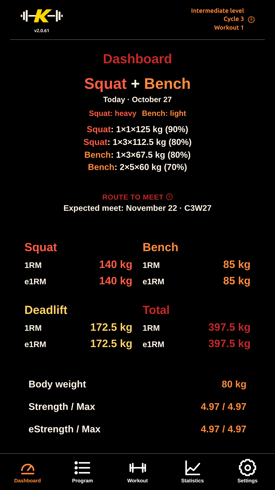
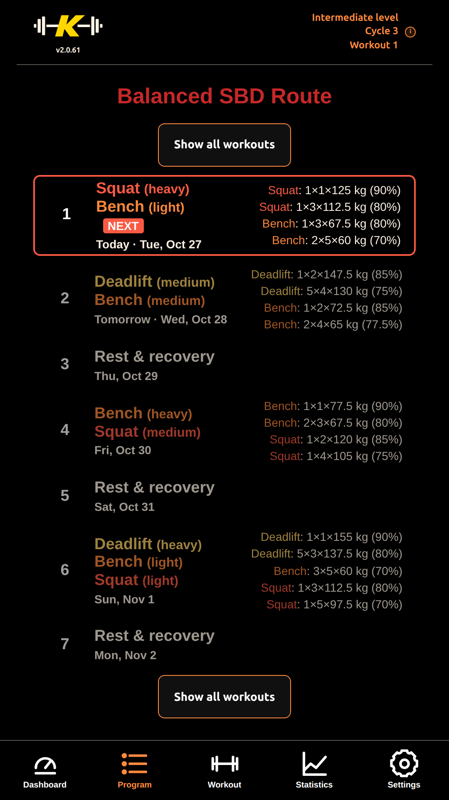
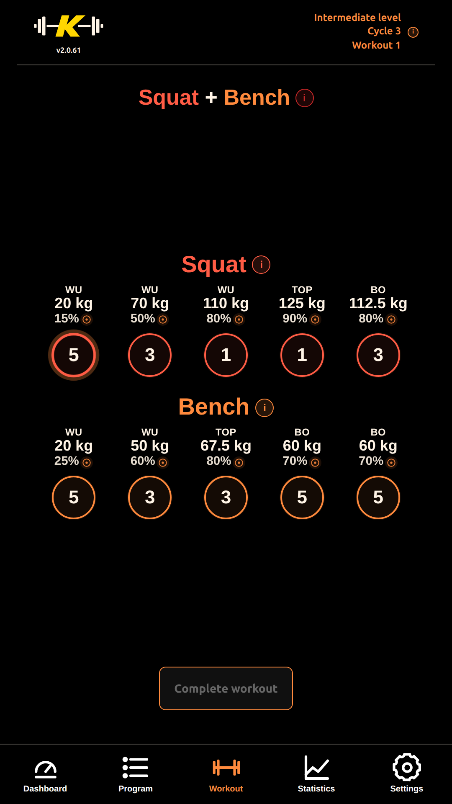
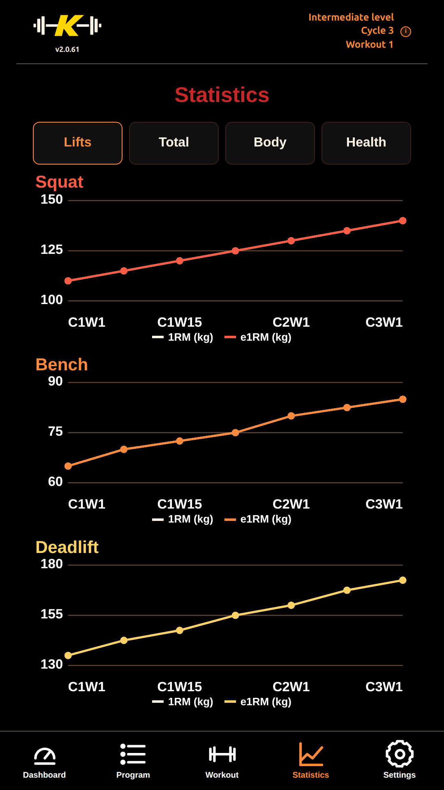

# Kelani SBD Tracker

[](https://github.com/mburgosfr-star/kelani-sbd-tracker/releases/latest)

**Offline-first Android powerlifting app for Squat, Bench Press and Deadlift.**

Kelani helps independent lifters plan adaptive SBD training, log workouts and follow strength progress. The app is free and open source, with no Kelani account, ads or subscription.

**Official project website and source:** [mburgosfr-star/kelani-sbd-tracker](https://github.com/mburgosfr-star/kelani-sbd-tracker).

[Download and get started](#download) · [Screenshots](#screenshots) · [How Smart Training works](#how-smart-training-works) · [Support development ($5 once)](https://github.com/sponsors/mburgosfr-star/sponsorships?amount=5&frequency=one-time)

## Download

An experimental [Windows desktop prototype](docs/windows-prototype.md) is also
available to build from source for testing. It is not a stable Windows release
and does not synchronize automatically with the Android app.
An experimental [Ubuntu DEB package](docs/ubuntu-prototype.md) runs the same
desktop app on Ubuntu 24.04 or newer (amd64). Its profile is separate from
Android, with no automatic phone synchronization or desktop updates.
Download Ubuntu test packages from **Kelani Ubuntu Test** prereleases
on the [releases page](https://github.com/mburgosfr-star/kelani-sbd-tracker/releases)
or from the official [itch.io page](https://kelburgos.itch.io/kelani-sbd-tracker-ubuntu).
The itch.io download is free, with an optional pay-what-you-want contribution.
Follow the [Ubuntu installation and verification guide](docs/ubuntu-prototype.md).

Available for **Android 7.0 or later**:

- [Download the latest APK from official GitHub Releases](https://github.com/mburgosfr-star/kelani-sbd-tracker/releases/latest). Open **Assets** and choose the `.apk` file.
- [Get Kelani from IzzyOnDroid](https://apt.izzysoft.de/packages/com.kelani.sbdtracker), also available through compatible F-Droid clients such as Neo Store.
- [Download Android on itch.io](https://kelburgos.itch.io/kelani-sbd-tracker-android), free with an optional pay-what-you-want contribution. Check the version shown there against the latest GitHub release; updates are installed manually.

Open the APK and follow Android's installation prompts, or install it through your F-Droid client. Then enter your starting lift maxes, choose your workout setup and start Smart Training. No Kelani sign-up is needed.

Official Android downloads use package `com.kelani.sbdtracker`. See [VERIFY.md](VERIFY.md) for official download sources, checksums and signing-certificate verification.

## Screenshots

Kelani SBD Tracker 2.0.59, shown with fictional demo training data.

| Dashboard | Program |
|---|---|
|  |  |

| Workout | Statistics |
|---|---|
|  |  |

## What Kelani Does

Main screens share a compact header with the Kelani mark, app version, experience level, cycle and workout. The header and bottom navigation reserve equal height; each screen has its own title in the content area.

- Prescribes heavy, medium and light SBD training with barbell-loadable weights.
- Uses real 1RM values for meet planning and tracks estimated 1RM progress from successful sets.
- Responds predictably to workout feedback: **Too easy** shortens the route to the meet, while **Too hard** or failed work adds recovery.
- Builds toward meet attempts, tapers and schedules an SBD Meet Day.
- Shows past, current and provisional future workouts, and explains readiness and expected meet timing.
- Tracks 1RM, e1RM, SBD totals, Strength, eStrength and body statistics.
- Reviews each completed cycle with workout and rest-day counts, successful lift results, progress since the start, and a chart of the best recorded 1RM total. Support and feedback actions are available in the review. Navigating to another screen starts the next cycle.
- Can optionally add future workouts to a selected Android calendar after you grant calendar access and start the first sync. Planning includes the remaining current cycle and one provisional next cycle, which can change with training results and settings. Events receive a reminder at their start time, which you can adjust in your calendar. Workout events you manually delete stay deleted during later syncs. You can also choose to remove Kelani's calendar events for completed workouts. The selected calendar provider may sync those events to your account.
- Can check GitHub for newer releases and link directly to GitHub or IzzyOnDroid without downloading or installing anything automatically.

Workout set controls use a shared five-column grid. Newly generated back-off and work-set blocks contain 1–5 sets. Smart Training back-off and work-set prescriptions use 3–4–5 repetitions for heavy, medium and light work. Their target percentages decrease across the three normal phases: 80–75–70%, 75–70–65% and 70–65–60%, respectively. During taper they are 70%, 65% and 60%. Top-set prescriptions are unchanged. Completed and already-started workouts retain their saved prescriptions.

During training you can complete or fail sets, adjust and restore weights, use a rest timer and open the plate calculator. Failed sets automatically make the workout **Too hard**; optional work left unchecked is not treated as failure.

## How Smart Training Works

Smart Training follows a level-specific 28-workout ideal route: W1-W21 build strength, W22-W26 taper, W27 is SBD Meet Day and W28 is the planned post-meet recovery day. The Program screen shows the route ahead, while your confirmed strength determines the prescribed weights. Select a future workout to inspect its full content in view-only mode. It cannot be completed or edited; choosing Workout in the navigation returns to your current session. **Too easy** shortens the route unless Meet Day is already next, while **Too hard** or failed work can add recovery without ever scheduling more than two consecutive rest days. Readiness information explains your progress without silently replacing planned workouts or postponing the meet.

## Your Workout Setup

Preparation and accessories are personal. In **Settings → Workout setup**, you decide:

- whether preparation and accessories are enabled;
- which available exercises belong to each big lift;
- how many sets and reps each exercise uses.

Kelani places your selected exercises into relevant workouts and chooses their training intensity. Optional preparation, accessories and cooldown work can be left undone without becoming failed work. Meet Day contains only the competition lifts.

## Private by Default

Kelani has no accounts, ads, telemetry, automatic analytics or Kelani-operated cloud synchronization. Training calculations and saved app data stay on your device unless you explicitly export or share them. If you enable the optional Android calendar integration, Kelani asks for calendar read and write access, stores the selected calendar and event links locally, and writes brief workout events to that calendar. Your chosen calendar provider may sync those events through its own service. Optional release checks request only public version metadata and can be enabled in Settings.

The optional anonymous usage summary is generated locally and shown in full before you choose to copy or email it. See the [privacy policy](docs/privacy-policy.md) for details.

## Support and Feedback

If Kelani is useful to you, you can [support its development with a one-time US$5 contribution through GitHub Sponsors](https://github.com/sponsors/mburgosfr-star/sponsorships?amount=5&frequency=one-time). Support helps maintain and improve the app. There is no subscription. GitHub requires you to sign in before contributing. Sponsorship is optional; the app available from GitHub and IzzyOnDroid does not require payment.

You can also optionally contribute when downloading the [Android app](https://kelburgos.itch.io/kelani-sbd-tracker-android) or [Ubuntu test release](https://kelburgos.itch.io/kelani-sbd-tracker-ubuntu) on itch.io, with a suggested US$5 amount. Choose **No thanks, just take me to the downloads** to download for free. Contributions unlock no additional app features. itch.io and its payment providers handle checkout separately from the app; see the [privacy policy](docs/privacy-policy.md#external-downloads-and-optional-payments).

Report bugs or suggest improvements through [GitHub Issues](https://github.com/mburgosfr-star/kelani-sbd-tracker/issues).

## Languages and Training Models

Kelani is available in English, Catalan and Dutch. New users start with Smart Training. The earlier fixed Classic programs remain available to existing Classic users in maintenance mode; they can continue or switch permanently to Smart using their existing history.

## Moving from Kelani 1.x

Kelani 2.x uses a new Android identity, so Android can keep 1.x and 2.x installed side by side. Export a JSON backup from 1.x, import it into 2.x and verify your data before removing the legacy app. Existing 2.x users update normally.

## Development

Use Node.js 22. Android builds additionally require Java 21.

```bash
npm ci
npm run security:check
CI=true npm test -- --runInBand
npm run build
```

Public Android releases use the repository's guarded release automation.

## License and Project Identity

Kelani is maintained by [Kel](https://github.com/mburgosfr-star) and released under the [MIT License](LICENSE). See [BRANDING.md](BRANDING.md) for official project-identity guidance.
